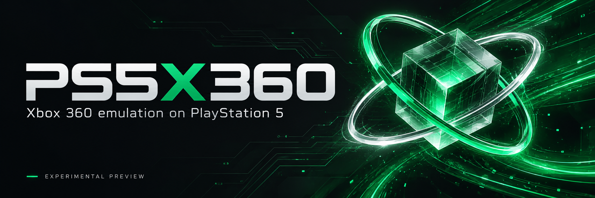
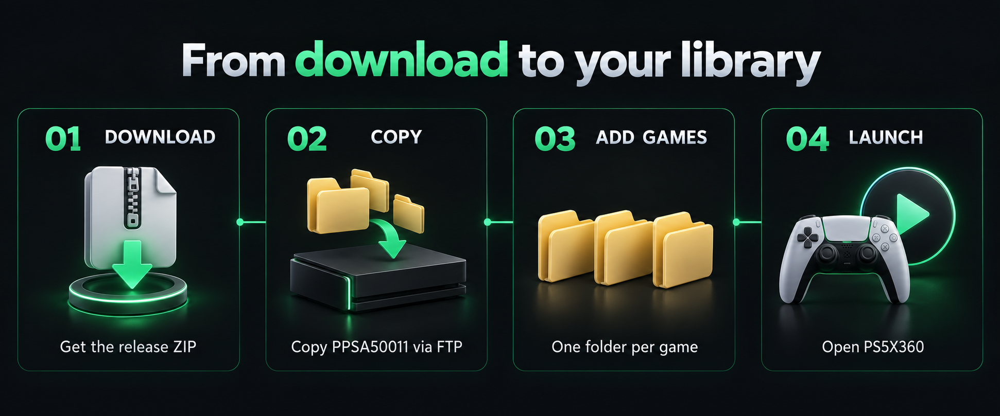

<p align="center">
  
</p>

<p align="center">
  <a href="https://github.com/BrinooTk/PS5X360/releases"><strong>Download a release</strong></a> ·
  <a href="docs/INSTALLATION.md">Installation guide</a> ·
  <a href="docs/GAME-CONTENT.md">DLC, updates and discs</a> ·
  <a href="docs/COMPATIBILITY.md">Compatibility</a> ·
  <a href="https://github.com/BrinooTk/PS5X360/issues">Report an issue</a>
</p>

# PS5X360

An **Xbox 360 emulator for PlayStation 5**, built on Xenia Canary with native DualSense input, audio output and RADV Vulkan graphics.

**Games already run on the development PS5. Compatibility varies, and development is ongoing.** Expect crashes, visual errors and uneven performance in some titles. There is no promise of full-library compatibility or 60 FPS.

## Latest release: v1.0.0

The first 1.0: a new home screen in the manner of the Xbox 360 dashboard, the games' own system
windows (sign-in, saves, messages) on screen, the newest Xenia Canary core, online play
(experimental) and System Link. [Read the release notes](docs/releases/v1.0.0.md), including
what was and was not seen on a console.

### What's new in v1.0.0

- **New home screen.** Channels **Início**, **Configurações** and **Online**, slots that turn
  away in perspective, and the game played last first, as "Jogar *game*" over the game's own
  Marketplace picture and icon. Then the game library, the player and the achievements.
- **Library of covers** with an opening animation; light grey look across the whole emulator,
  PlayStation button shapes, and a restyled in-game guide that pauses the game, as the Xbox guide.
- **Games' system windows on screen.** Who is playing, where to save, messages and the keyboard
  answer to the controller. Bayonetta's title screen takes START again.
- **Controller fix** for games that wait for "any controller".
- **Newest Xenia Canary core** (e6cd2e4), per-game core settings from Xenia's compatibility
  reports, graphics presets for about 220 games, and fixes such as WWE's loading screen.
- **Online play over the internet** (Xenia netplay, public server) and **System Link** —
  experimental: the online connection is still being brought up on the PS5.
- **Your own Xbox 360 dashboard** (`dash.xex` from your console) can be opened from the home.

Known problems: Need for Speed Most Wanted (2012) stops when driving starts (a known Xenia
crash), Xbox avatars are not drawn, Kinect is experimental.

## What is included

- A home screen and cover library for extracted games (XEX), ISO images and GOD/STFS packages,
  with folders and filters.
- **DLC and title updates** installed from the game's sheet or by themselves when you press Play;
  **games with several discs**. See [DLC, updates and discs](docs/GAME-CONTENT.md).
- Per-game settings and community Xenia Canary patches, matched to the game's executable version.
- Player profiles for up to four local players, saved games and achievements with notifications.
- An in-game guide opened with the touchpad: resume, library over the running game, settings.
- Frame generation (FSR3, experimental), FPS display, CAS sharpening and FSR upscaling.
- Kinect with a phone or a USB Kinect (experimental), settings from a phone or computer.
- Covers from XboxUnity and Microsoft's image server; an interface in **English, Portuguese and
  Spanish** following the PS5 language.
- Per-game log files, downloadable as a ZIP.

## Quick installation



1. Download `PPSA50011.zip` from [Releases](https://github.com/BrinooTk/PS5X360/releases).
2. Extract it on your computer.
3. Using FTP, copy the complete `PPSA50011` folder to **`/data/homebrew/PPSA50011`** on your PS5.
4. Let ShadowMountPlus register the title, then open **PS5X360** from the PS5 home screen.
5. Put each game in its own folder under `PPSA50011/assets/roms/`. Reopen the emulator or select **Settings → Refresh game list**.

The development setup uses **PS5 firmware 13.60 with homebrew access, etaHEN, ShadowMountPlus and kstuff**. Other setups have not been verified. This application requires an already working homebrew environment.

[Read the full installation and usage guide →](docs/INSTALLATION.md)

## Organize your games

```text
PPSA50011/
├── eboot.bin
├── sce_module/
├── sce_sys/
└── assets/
    └── roms/
        ├── Game One/
        │   ├── default.xex
        │   └── ...game data...
        ├── Game Two/
        │   └── game.iso
        └── Game Three/
            ├── ...GOD or STFS package...
            └── ...matching .data folder, if required...
```

Keep all extracted game data together. Use
**Settings → Game folders** to add multiple locations, including accessible
external mounts.
See the [folder configuration guide](docs/INSTALLATION.md#multiple-locations-and-external-devices-development-v030-preview).

**No games, console BIOS or keys are included.**

## Controls

| DualSense button | Home | Library |
| --- | --- | --- |
| D-pad / stick up and down | Change channel | — |
| D-pad / stick left and right | Choose a slot | Choose a game |
| Cross | Open | Open the game's sheet (Play, Patches, Settings, Achievements, DLCs, Updates) |
| Triangle | — | The game's settings |
| Square | Settings | Settings |
| L1 / R1 | — | Change library filter |
| Circle | — | Back to the home |
| Touchpad, during a game | Open the emulator guide | |

The guide offers resume, the library over the running game, settings, Xbox BACK and exit. To use
the touchpad as Xbox BACK instead, change **Settings → Touchpad click**; the guide then opens with
**OPTIONS + touchpad**.

## Compatibility and bug reports

Booting into a menu is not the same as completing gameplay. Some titles still fail during scenes or fights. [Current compatibility notes](docs/COMPATIBILITY.md) distinguish console observations from host tests.

When [reporting a bug](https://github.com/BrinooTk/PS5X360/issues), include the game, title ID, region/version, enabled patches, firmware, release version and the exact point where it fails. Include a short video or screenshot and the matching game-session logs from `LOGS` (development v0.3.0-preview), or `engine.log` for older builds. The included log downloader can create a ZIP ready to share.

## Development

The v1.0.0 core is Xenia Canary e6cd2e4 with Xenia Canary netplay (AdrianCassar,
`netplay_canary_experimental` d2cf527aa). The PS5 changes over it are in the release's
`PS5X360-source-1.0.0-changes.zip`; earlier core changes are stored in
`patches/canary/xbox360ps5.patch`; the launcher and platform adapters live in this repository.

[Build notes and source dependencies](docs/BUILD.md) · [Third-party credits](docs/CREDITS.md)

The current release is **v1.0.0**. See the [changelog](CHANGELOG.md) and
[release versioning guide](docs/RELEASING.md) for future updates.

## Support the projects

If you would like to support development of PS5X360 and my other projects,
you can contribute through [Ko-fi](https://ko-fi.com/brinoblitz).
Contributions are optional and always appreciated. Testing, bug reports and
sharing the project also help.

Older M0–M8 milestones and Portuguese research notes are preserved in [the port history](docs/PORT_HISTORY_PT.md). They describe earlier stages and do not replace the current release status.

## Credits and licenses

Based on [Xenia Canary](https://github.com/xenia-canary/xenia-canary), with the [PS5_Vulkan](https://github.com/mihawk-99/PS5_Vulkan) RADV work and native runtime/tooling from the projects listed in [Credits](docs/CREDITS.md). Online play comes from [Xenia Canary netplay](https://github.com/AdrianCassar/xenia-canary) by AdrianCassar, with libcurl, wolfSSL and miniupnpc; frame generation from [ps5-framegen](https://github.com/Swordpdf/ps5-framegen) by Swordpdf. Community patches come from [xenia-canary/game-patches](https://github.com/xenia-canary/game-patches); covers use XboxUnity and Microsoft's image server.

Original project code is licensed under MIT. Bundled third-party components keep their own licenses, including BSD, LGPL and GPL components. See [LICENSE](LICENSE), [licenses/](licenses/) and the font's [SIL Open Font License](assets/fonts/OFL.txt).

PS5X360 is an independent community project and is not affiliated with Sony or Microsoft. README artwork is illustrative branding, not an emulator screenshot.

## Downloads

The [v1.0.0 release](https://github.com/BrinooTk/PS5X360/releases/tag/v1.0.0)
offers **PPSA50011.zip** and **PS5X360-source-1.0.0-changes.zip** (the source of what this
release adds; it links wolfSSL, GPL-3.0). Extract the ZIP and copy `PPSA50011` to
`/data/homebrew/`. Preserve existing games, saves (`saves/`) and logs when updating. The optional
**AutoLog 1.0.9-preview ELF** is attached to earlier releases. AutoLog is loaded separately once per console boot;
it sends diagnostic excerpts to the developer. Read its
[reporting notice and instructions](native/autolog/README.md) before enabling it.
The collector's corresponding source and license archive is included under
`PPSA50011/licenses/`.

## Automatic diagnostic reports

A separate **AutoLog ELF preview** reads game logs on the PS5 and submits them
to the preconfigured Cloudflare-to-Discord relay, without a PC collector.
Load it once per console boot after reading the reporting notice. Direct game
report delivery was verified on the owner's PS5 with firmware 13.60. Keep the
console FTP service enabled for the directory fallback; other firmware is unverified.
See [console collector instructions](native/autolog/README.md) for opt-out and
limits, or [AutoLog setup](docs/AUTOLOG.md) for the optional PC fallback.


